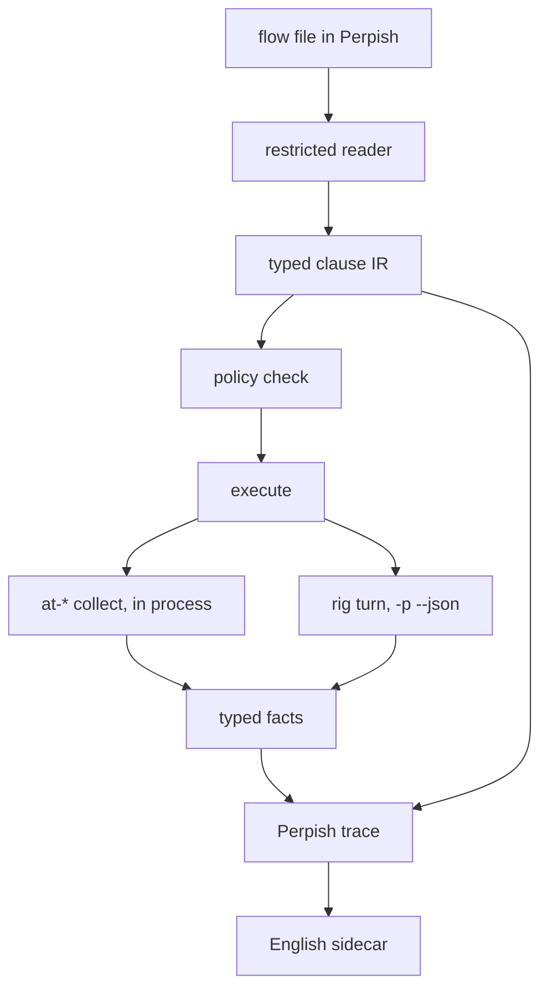

# Perpish as a flow language for rig

Investigation, 2026-11-15. Nothing here is built. Every Perpish sentence below was rendered by
`perpish`'s own API from a probe under `.tmp/perpish-probe`, against the working tree at
`~/code/hodlcroft/compositor` (commit `58193fc5`, with uncommitted changes in `crates/perpish`).
The rig claims are the ones in [`rig.md`](rig.md), re-read at `~/code/defrag/rig`; the effect
record fields were checked in `crates/rig-core/src/effect/mod.rs:824-905`.

The short version: **Perpish is a conlang with a clause grammar and no parser. That is the wrong
tool for writing a flow and the right one for recording one.** The grammar carries three things an
agent stack loses: case particles make an argument's role explicit, mood is separate from tense,
and a complement clause says who said what. The investigation is whether the same clause can be the
plan, the permission and the record.

> Dr. Vape's rejects. Prints, but never equal. Some came out with a job; most came out with a
> grudge.

The language was built for a lab's filing system: designations, roles, a record of what came out
wrong. The playbook is a lab's filing system too, with rules instead of roles and findings instead
of rejects. That is why the fit is less absurd than it looks.

The toolkit already has small DSLs: `at-cardano`'s scenario file, `browser-shot`'s and
`tui-shot`'s. All are machine-first — a verb, a target, an assertion, one line each — and each has
a purpose-built reader. Perpish is the opposite bet: a grammar built for a human reader, with the
machine's semantics in the host. If it works, a person who has learned a page of grammar can read
the trace, and the runner is still typed Rust.

## What this decides

1. **The first thing to build is a trace, not a language.** Project the rig effect log into
   Perpish with an English sidecar. No parser, no runtime, no vocabulary change. If the trace is
   not more readable than the JSON, the investigation stops there and keeps a lab log.
2. **The second is a policy subset.** The gate-shaped rules become modal clauses, checked at the
   rig `Gate`, with the rule id as the authority. This tests the one distinction the current rule
   system cannot state: prohibition versus no obligation.
3. **Flow authoring is the third experiment, behind a restricted reader.** It is the only part that
   needs a parser, and the part most likely to fail. It does not begin until 1 and 2 pass.
4. **The composer stays std-only.** The flow runner is a tool (`at-flow`), in the shape of
   `at-cardano run --scenario`, not a new mode of `playbook`.
5. **Perpish is consumed at a pinned rev, and vocabulary is added upstream in compositor, never
   forked.** A local dialect is the drift this repository exists to prevent. The compositor
   currently declares no SPDX license; that must be settled before `at-flow` is published.
6. **The model never writes Perpish.** The grammar belongs to the host. The model's prose stays
   prose; a trace says *that* an answer came and who gave it, not what it said. The language costs
   the model no tokens: it is rendered and parsed on the host, and the model sees the English
   sidecar.

## What Perpish is, verified

| Claim | Where |
| --- | --- |
| The checkout is `~/code/hodlcroft/compositor`; there is no `~/code/defrag/compositor`. The defrag `shared-crates/compositor` is four unrelated renderer crates. | `ls` on both |
| The crate is pure: no dependencies, no I/O, no wasm-bindgen. | `crates/perpish/Cargo.toml` |
| It does three jobs: name things (shipping), describe things, say things. The clause grammar is the third. | `docs/perpish-language-spec.md` §1 |
| Strict SOV, head-final; 12 cases; 3 tenses; 6 moods; `nu` placement; `se`; `ko`; `ʃ`/`shi`; `ke`; `pe`; `-in`; filing stems. | `crates/perpish/src/phrase.rs`, `docs/perpish-in-ten-minutes.md` |
| The phrase layer is a **renderer**. A caller builds a `Clause`/`Sentence` and calls `render()`. There is no text-to-AST reader. | `src/phrase.rs`, `examples/*` |
| The embedded lexicon is roots + two concept batches + fixed lore words. Concept roots are generated from glosses, never enter the naming pool, and are skipped when a gloss already exists. | `src/lexicon.rs:942-957`, `generate_lore_roots` |
| The dictionary is about 2,298 roots: 401 naming roots (350 common, 47 loans, 4 reserved), 1,875 generated concepts and 22 fixed lore words. | `crates/perpish/README.md` |
| `NameBook` is deterministic from `(seed, key)`; a name is a proper noun and cannot fill a common-noun slot. | `src/naming.rs:404-440`, `src/phrase.rs::is_word_root` |
| `ʃ` is the only non-ASCII sign; a typed `shi` is normalised to it. | `src/orthography.rs` |
| The numeral readings collide with roots: `gub` is 0 and *defect*, `sarn` is 100 and *batch*, `vot` is 1000 and *vat*. | `src/numeral.rs:10-17`, `data/roots.psv` |

The grammar in one paragraph: a clause is `[address] subject [quote] object adjuncts [pe] [mood]
([nu] predicate | [nu] verb) [ke]`. A noun is a root plus a filing stem (High) or the bare root
(Low), then a case particle. A verb is a root, an optional tense (`-em`, `-ek`, `-un`), and `-in`
when its object is sentient. A verb with no tense is an imperative. `nu` before the modal negates the
modal (`nu si`, *need not*); `nu` after it negates the verb (`si nu`, *must not*). A relative clause
ends in `ʃ` and precedes its head; a complement clause ends in `ko` and sits in the object position;
a conditional protasis ends in `se`; `ke` at the end asks a yes/no question; `pe` hedges.

## The three distinctions

### 1. Case particles are labelled arguments

A tool call is a verb with a flat list of flags. A clause is a verb with roles:

```text
Sneimna u stekna pa stoum.
file OBJ pattern INSTRUMENTAL search-IMPERATIVE
"Search the file by means of the pattern."
```

`Sneimna` is the file, `u` says it is the object, `stekna` is the pattern, `pa` says it is the
instrument, and `stoum` is the act. The mapping to `at-peek search <pattern> <file>` is direct: the
instrument is the pattern, the object is the scope. The renderer validates every root, the filing
stem and the verb's class, so a sentence cannot use a noun root as a verb or an unknown class stem.
It does not enforce a per-verb case frame; that frame is what a flow's schema would add.

The same shape carries a subagent dispatch:

```text
Va i mourna u prausna wo speldemin.
I SUBJ envoy OBJ rule ALLATIVE send-PRESENT-SENTIENT
"I send the envoy to the rule."
```

`-in` marks the object as sentient: the thing being sent is an agent, not an artefact. That is a
distinction the current tool schema has no field for.

### 2. Mood is separate from tense

The modal is tenseless; the verb carries the time. That is exactly the shape of a policy: a rule
is an obligation that does not expire, and an action is the thing that happened.

```text
Harna i sneimna u si nu draudem.
harness SUBJ file OBJ must not write-PRESENT
"The harness must not write the file."       ← prohibition

Harna i sneimna u nu si draudem.
harness SUBJ file OBJ need not write-PRESENT
"The harness need not write the file."       ← no obligation
```

The two sentences differ only in the order of `nu` and `si`, and they are the two things a rule
about a tool call has to say. The playbook's prose rules say "never" and "ask before"; the rig
`Gate` decides allow/refuse. Neither carries "not required" as a first-class value. Perpish does.

The six moods are `ki` can, `nu ki` cannot, `pi` may, `nu pi` may not, `si` must, `nu si` need not.
A gate needs the prohibitions and permissions; the rest are for the trace.

### 3. Reported speech has provenance

A tool result is not the flow's own claim. It is something a tool said. Perpish has a clause for
that:

```text
Va i prausna i sneimna u trasem ke ko harna e klevem.
I SUBJ [rule SUBJ file OBJ touch-PRESENT QUES] QUOTE harness DAT ask-PRESENT
"I ask the harness: does the rule touch the file?"

Harna i prausna i sneimna u trasem ko plomem.
harness SUBJ [rule SUBJ file OBJ touch-PRESENT] QUOTE say-PRESENT
"The harness says that the rule touches the file."
```

The quote is a complement clause closed by `ko`; the matrix verb says who said it. Direct and
indirect speech differ by pronoun (`va` direct, `ve` indirect), so the trace can distinguish the
agent's own voice from what it was told. A model's answer is exactly a quoted blob: the trace can
say *that the harness answered* without pretending the answer is the flow's conclusion.

The fourth scoping device is the relative clause, which is a filter over a head:

```text
Va i sneimna i poulem ʃ prausna u kundem.
I SUBJ [file SUBJ include-PRESENT ʃ] rule OBJ know-PRESENT
"I know the rule that the file includes."
```

The relative precedes the head; the head keeps its own case; the gap's role is inferred. That is a
query written as a noun phrase: *the rule that …*, *the test that failed*, *the file that contains
the secret*. A flow can name a result by a predicate instead of an index.

## Grammar to flow, one row at a time

| Perpish construct | What it encodes | Flow concept | The current stack |
| --- | --- | --- | --- |
| strict SOV, head-final | bind the arguments, then act | a step is a verb with its cases bound | a JSON tool call |
| case particle | the role of an argument | typed argument | a tool schema |
| tense suffix | executed, planned | step state | a trace timestamp |
| modal `si`/`ki`/`pi` | obligation, ability, permission | policy | rule prose |
| `nu` position | must-not versus need-not | prohibition versus no obligation | "never", "not required" |
| `se` | a guard | conditional step | `if` in code |
| `ke` | a question that must be answered | check | an assertion |
| `ko` + a speech verb | a reported result | tool or subagent result | tool result text |
| `va`/`ve` | direct versus indirect voice | raw versus summarised | a provenance field |
| `ʃ` relative | a scoped selection | query or filter | search arguments |
| `-in` | a sentient object | agent versus artefact | a tool target |
| filing stem | the noun's type | value type | a schema |
| `pe` | hypothesis or uncertainty | dry-run, approval | none |
| `cho` | a cause | parent or cause link | the effect's `parent` |
| High versus Low | the lab's record versus the street's voice | system versus agent provenance | a log level |

## The same clause in three moods

| Role | Perpish | English | What it is |
| --- | --- | --- | --- |
| plan | `Sneimna u speik.` | Read the file. | an imperative; no subject, no tense |
| trace | `Va i sneimna u speikek.` | I read the file. | the plan's verb and object, past tense, actor added |
| policy | `Harna i sneimna u si nu draudem.` | The harness must not write the file. | a tenseless modal over the same act |
| check | `Sneimna i prausna u poulem ke.` | Does the file include the rule? | a question; `ke` is sentence-final |
| report | `Harna i prausna i sneimna u trasem ko plomem.` | The harness says that the rule touches the file. | a complement; who said it |

This is the claim worth testing: **the plan, the permission and the record are not three schemas.**
They are the same clause with a different mood or tense. In the current stack they are a prompt, a
rule in `AGENTS.md`, and an `EffectRecord` with a different shape again. If the claim survives a
runtime, a flow gets its plan, its policy and its trace from one grammar, and a conformance check
becomes a comparison of clauses rather than a comparison of prose to logs.

If it does not survive — if the trace needs information the plan never had, or the policy cannot be
stated over the same act — then Perpish is a good notation for the trace and nothing more. That is
still a result, and it is the first experiment.

## A worked flow

The flow: *does a rule reach the harness?* Each numbered line is the probe's exact Perpish, with
its English beneath. Every word is from the embedded lexicon; no concept was added.

```text
1.  Prausna u sneimna o trep.
      Find the rule in the file.

2.  Sneimna u speik.
      Read the file.

3.  Sneimna i prausna u poulem.
      The file includes the rule.

4.  Sneimna i prausna u poulem se prausna i harna u trasem.
      If the file includes the rule, the rule touches the harness.

5.  Va i prausna i sneimna u trasem ke ko harna e klevem.
      I ask the harness: does the rule touch the file?

6.  Harna i prausna i sneimna u trasem ko plomem.
      The harness says that the rule touches the file.

7.  Harna i sneimna u si nu draudem.
      The harness must not write the file.

8.  Harna i sneimna u nu si draudem.
      The harness need not write the file.

9.  Prausna i si nu zimem.
      The rule must not fail.
```

1–4 are the script: two reads, an observation and a guard. 5 and 6 are the check: the flow asks,
the harness answers, and the answer is quoted. 7–9 are the policy: one prohibition, one
non-obligation, and the rule itself as a modal. The policy is not a separate document; it is the
same verbs and cases in a different mood.

The same grammar carries the shapes a trace needs:

```text
10. Va i sneimna i poulem ʃ prausna u kundem.
      I know the rule that the file includes.

11. Prausna i harna u pe trasem.
      Perhaps the rule touches the harness.

12. Va i zimna cho flasem.
      I stop because of the failure.

13. Va i glautna u nudem.
      I record the verdict.

14. Sneimna u stekna pa stoum.
      Search the file by means of the pattern.

15. Stoumna i skop sneimnan u trepek.
      The search found three files.

16. Va i sneimna u speik ko mourna e skoltem.
      I tell the envoy: read the file.

17. Va i mourna u prausna wo speldemin.
      I send the envoy to the rule.
```

10 demonstrates a filter, 11 a hypothesis, 12 a cause, 13 the report, 14 a tool call rendered as
cases, 15 a past-tense observation with a numeral, 16 a delegation, 17 a sentient object.

A flow file is those sentences, one per line. There is no comment syntax, no import and no metadata
in the language: the runner's flags carry the target, and the sidecar carries the English. That is
a cost of the one-text principle, and it is one reason the authoring experiment is last. A flow is
a script with grammar, not a general-purpose program.

### The variables are names

A flow needs to bind a result and use it later. Perpish has no `let`, no `$1`, no array index. It
has names. A name is a proper noun: the writer capitalises it, and a name-only stem is refused in a
common-noun slot. A reader uses the slot and the capitalisation together — the first word of a
sentence is also capitalised, so the capital alone is not enough — and the name is a handle, not a
summary. The English sidecar says what it refers to.

```text
Grodadors
Torvagrot
Klintegrist
```

Those are the first three names `NameBook::new(7)` produces for the keys `check-manifest/1…3`,
rendered by the probe. The flow runner names each step's result deterministically from
`(flow, step)`, and a replay with the same seed reproduces the names. This is the naming layer
doing the job it already does for tokens — an individual, unique reference that does not reveal
order.

It also means a flow's intermediate values are not opaque handles in the log. They are
designations, in the same language as the rest of the sentence, and a reader can follow one from
step to step without a separate symbol table.

## The runtime

The language owns the shape; the host owns the semantics. That is the only division that keeps the
investigation honest. A sketch of the typed IR:

```rust
pub struct Flow {
    pub title: String,
    pub project: PathBuf, // the playbook manifest, for rule resolution
    pub steps: Vec<Step>,
}

pub enum Step {
    Act(Act),                                  // an imperative
    When { check: Check, steps: Vec<Step> },   // a guard
    Check(Check),                              // a question that must answer yes
    Policy(Policy),                            // a modal over an act
    Report(Value),                             // the typed value the flow returns
}

pub enum Act {
    Read(ReadCall),  // at-peek / at-recall / at-crate, in process
    Ask(AskCall),    // a rig turn or a subagent
}
```

There is deliberately no `Write` act in the first runtime. The flow is read-only until the policy
layer has proved it can refuse one.

Execution has two external seams and three controls:

- **A read** calls the verb's `collect` in process, exactly as `integrations/rig` already does, and
  publishes the typed facts. No subprocess, no `PATH`.
- **An ask** runs one rig turn. The first implementation uses `rig -p --json`, because it is already
  scriptable and the protocol is documented by `rig help-agents`; the library (`Agent::prompt`) is
  the alternative once the flow is inside a plugin. The prompt is the English sidecar for that
  clause; the model never sees the Perpish. The answer is a quoted blob, not a translation.
- **A check** is a read that must answer yes or no; if no tool can answer it, it is an ask with a
  yes/no prompt. `ke` is the assertion.
- **A policy** resolves the rule id against the playbook's block, checks the act's footprint, and
  records the decision at the `Gate`. The modal clause is the log line; the rule id is the
  authority.
- **A report** returns the typed value; the trace renders it as a predicate or a complement.

The trace is a projection of the effect log, not a second journal:

| `EffectRecord` | The clause says (in English) |
| --- | --- |
| `kind: tool_call`, `disposition: ran`, `Ok` | a past-tense act with its result: *The search found three files.* |
| `decided_by: plugin("playbook")`, `Err` | a modal refusal: *The rule forbids that the harness writes the file.* |
| `kind: completion`, `Ok` | a completion: *The harness answered the question*, with the answer kept verbatim |
| `reviewed: Some` | a reviewer report: *The reviewer says that …* |
| `disposition: superseded` | a replacement: *The playbook served the search with the read.* |

The fields are the kernel's: `kind`, `outcome`, `disposition`, `decided_by`, `published` and
`parent` are already in `EffectRecord` (`crates/rig-core/src/effect/mod.rs:824-905`). The trace adds
no instrumentation and no new journal. It reads what the turn already recorded.

One gap: `decided_by` names the plugin that decided, not the rule it enforced. Naming the rule in
the trace needs the policy to publish its id beside the decision, which is a small addition to the
plugin, not a change to the kernel.

The trace cannot carry arbitrary data. The lexicon is closed: a file path, a commit hash, a model
name and a line of prose are not Perpish words. The trace renders the roles, the counts and the
outcomes; the English sidecar carries the values verbatim, keyed by the sentence. A reader reads
the Perpish for the shape and the sidecar for the facts. That is a deliberate split: the language
stays learned and closed, and the dynamic data stays exact. It also means the sidecar is mandatory,
not a convenience.



The conformance check is the one to be suspicious of. The runtime can assert that the trace's
past-tense clause shares the plan's verb and cases, but if the runtime generates both from the same
IR, the assertion is a tautology. The fourth experiment is designed to catch that: a deliberately
wrong step in a plan, and a trace generated from what actually ran. If every trace still conforms,
the claim is dropped and the trace is kept as a log.

## Where it plugs into the playbook

### `tools/at-flow`

A proposed binary, in the shape of `at-cardano run --scenario`: a runner outside the agent, with a
typed contract and a bounded report.

```sh
# experiment 1: no parser, no model
at-flow from-effects RIG_HOME/sessions/<id>/files/effects.jsonl

# experiment 3: the reader and the runner
at-flow check .playbook/flows/check-manifest.flow     # parse, resolve rules, no model
at-flow render .playbook/flows/check-manifest.flow    # Perpish + English sidecar
at-flow run .playbook/flows/check-manifest.flow       # reads, asks, checks, policy
```

The first slice is `from-effects`: it needs nothing but the log, and it is the whole of experiment
1. `check` and `render` need a reader; `run` needs the runtime as well. All four depend on `perpish`
at a pinned rev, reuse `at-core`'s `Report`, and call the verb crates' `collect` in process. It is
not the composer, so the composer's no-dependency property is untouched.

### `integrations/rig`

First a **`TracePlugin`**: an observer that writes a Perpish trace beside `effects.jsonl`, with an
English sidecar. It changes no turn, no gate and no tool. It is the cheapest way to see whether the
trace is worth reading, and it exercises the same `EffectRecord` projection the runner will use.

Later a **`FlowPlugin`**: a `flow` tool that runs a flow whose read steps are the already-registered
typed tools, and whose ask steps are subagents. The `Gate` is the policy seam. The plugin's read
tools already publish typed facts, so the trace has the participants and the counts; for any tool
that does not publish facts, the trace falls back to the tool name and the outcome.

### `integrations/rig-eval`

The scenario JSON stays canonical. The corpus is a scored evaluator, and a Perpish scenario source
would add a translation layer to the measurement with no gain. The report gains a per-run trace and
its sidecar; the score does not change. The conformance experiment adds one scenario whose plan has
a wrong step and whose trace checker must catch it.

### `playbook`

No change. The composer is std-only on purpose (`Cargo.toml`), and the rule resolution is already
available as a library. `at-flow` reads the manifest and the resolved block; the policy authority
is the rule id, not a second copy of the rule text.

### `skills`

A skill is a procedure; a flow is a procedure with checks. The `capture-rule` skill could grow a
flow file whose `Check` steps are its success criteria, but the skill is the source of truth until
the flow earns it. Do not rewrite the skills for this.

## The vocabulary

The probe rendered the seventeen numbered sentences with **zero new concepts**. That is the
strongest argument for the trace experiment: it can start today, with the lexicon as it is.

What already exists, from the probe's vocabulary table:

| Domain | Roots |
| --- | --- |
| rule, file, harness | `praus` rule, `sneim` file, `harn` harness |
| verdict, report, evidence, proof, clause | `glaut`, `yail`, `trut`, `bem`, `klous` |
| question, reply, command, target, mission | `gleid`, `soun`, `blep`, `bron`, `gril` |
| code, message, plan, pattern | `blag`, `sleil`, `kreib`, `stek` |
| search, read, write, check, verify, test | `stoum`, `speik`, `draud`, `shup`, `sprop`, `gais` |
| record, include, touch, find | `nud`, `poul`, `tras`, `trep` |
| ask, say, tell, know | `klev`, `plom`, `skolt`, `kund` |
| fail, pass, stop, start | `zim`, `flul`, `flas`, `plaup` |
| approve, refuse, apply | `spleig`, `bloun`, `spoud` |
| observe, inspect, review, compare, measure | `zoun`, `draut`, `plas`, `straud`, `strul` |

What a real coding flow will want and does not have: *agent* (the nearest existing words are
`envoy`, `runner`), *tool* (`harn` already means harness), *model*, *prompt*, *context*, *session*,
*turn*, *step*, *flow*, *skill*, *diff*, *commit*, *branch*, *repository*, *project*, *manifest*,
*error*, *retry*, *trace*, *policy*, *gate*, *sandbox*, *subagent*. That is about twenty concepts,
mostly software nouns; the verbs are largely there.

Each is one line in a `flows.psv` batch, because a concept is `gloss|class` and its root is
generated. The naming pool is separate, so adding a concept cannot re-roll a token name. The
upstream change is small: add the batch to `EMBEDDED` in `lexicon.rs`, or expose a public
constructor for extra concept sources. The playbook pins the rev.

Two rules keep the generated vocabulary stable:

- **Append, never insert.** The roots are generated in concept order, with a salt on collision. A
  concept inserted ahead of an existing one can take its root. A new batch goes last.
- **A root change is a migration, not a rename.** A flow file cites the rendered roots. If the
  inventory changes them, the flow is re-rendered and the diff is reviewed. The pinned rev makes
  that a decision rather than a surprise.

The license is the one blocker for publishing `at-flow`: the compositor's workspace declares no
SPDX license. For a personal tool the path dependency is fine; a published crate needs the question
answered first.

## The reader

The crate has a writer, not a reader. A flow authoring surface needs a reader, and that is the
expensive part. It is also smaller than it looks, because the hard pieces already exist: the
lexicon, the morphology, the case and mood tables, and a deterministic renderer to test against.

The reader should parse a **profile** of Perpish, not the whole language: imperative, past,
present, future, modal, conditional, question, quote and relative. Coordination, vocatives and the
partitive are refused with a clear error. A profile is not a dialect: it accepts the same sentences
the renderer emits, and it refuses the ones a flow has no meaning for.

The ambiguities, in order of cost:

- **A word can be a noun or a verb.** Both are closed syllables. The slot decides: after a case
  particle it is a noun; at the end of a clause it is a verb, with a tense suffix or none. A verb
  with `-in` is a sentient object.
- **A root can itself end in a filing stem.** The lexicon knows the roots; try the full word as a
  root, then split the longest class stem and look up the base.
- **A numeral collides with a root.** `gub` is 0 and *defect*, `sarn` 100 and *batch*, `vot` 1000
  and *vat*. A numeral is in the numeral slot before a noun; a noun is followed by a case particle
  or the verb. Lookahead resolves it.
- **The relative clause has a gap.** The head's case is outside the relative; the gap's role is
  inferred. Keep `Role::Inferred` and let the runtime resolve it from the head and the verb's
  arity. This is the one place a reader is genuinely harder than a writer.
- **`nu` has two positions and two meanings.** Keep the token order; the AST has both the modal and
  the clause negation. `nu si` and `si nu` are not the same clause.
- **The address and the question are sentence-level.** Only the first clause may carry an address;
  only the last may ask.

The test is an oracle the writer already provides: take the ASTs the crate's examples build,
render each, parse the text, and compare the AST. Then a property test: for random ASTs within the
builder's constraints, `render(parse(render(ast))) == render(ast)`. If the reader cannot round-trip
the writer, it is not a reader of the same language. The flow profile is then a filter over the
parsed corpus, not a second grammar.

An estimate: 800–1,500 lines with tests, if the lexicon and morphology are reused. The parser is
not the hard part; the gap and the numeral collisions are.

## The experiments, in order

| # | Experiment | Answers | Size | Kill |
| --- | --- | --- | --- | --- |
| 1 | **Perpish trace of `effects.jsonl`** — a `TracePlugin` or `at-flow from-effects`, with an English sidecar | Is the trace more readable than the JSON? | 1–2 days; no parser, no vocabulary | a reader is not faster on five questions; more than 5% of effects unrenderable |
| 2 | **Modal policy subset** — the gate-shaped rules as modal clauses, checked at the rig `Gate` | Do the rules formalise without loss? | 2–3 days; no parser | fewer than five gate-shaped rules, or "ask before" cannot be expressed |
| 3 | **Restricted flow reader and runner** — the 17-sentence flow, on a real playbook task | Is a flow cheaper or safer than a prompt and a script? | 1–2 weeks | the reader exceeds 1,500 lines or fails the round-trip; the flow costs more than the baseline |
| 4 | **Plan–trace conformance** — a plan with a deliberately wrong step, a trace from what ran | Is the same-clause claim real, or a tautology? | 2–3 days after 3 | every trace conforms by construction; drop the claim |
| 5 | **Vocabulary audit** — one real flow, count the missing concepts | Does the language carry the domain? | 1 day | more than 30 new concepts for one flow |

The order is deliberate. 1 and 2 need no parser, and 1 needs no vocabulary change. 3 is the
expensive one and the one most likely to fail. 4 tests the thesis; 5 checks the cost. A negative
result at 1 is still a useful artefact — a lab log in a lab language — and it costs two days.

## What we verified, and what we did not

Verified this session:

- The examples render, through `perpish`'s own API: the probe under `.tmp/perpish-probe` printed
  every sentence below and the three names. The embedded lexicon resolved every root.
- The mood pair: `si nu` renders *must not*, `nu si` renders *need not*.
- The concept glossary: `rule`, `file`, `harness`, `search`, `read`, `write`, `check`, `verify`,
  `test`, `report`, `record`, `ask`, `say`, `tell`, `know`, `fail`, `stop`, `approve`,
  `refuse`, `apply`, `observe`, `inspect`, `review`, `compare` and `measure` all resolve to action
  or noun roots in the embedded lexicon.
- The relative, conditional, complement, question, hedge and causal forms render.
- The number collisions: `gub`, `sarn` and `vot` are both numerals and roots.
- The playbook's composer has an empty `[dependencies]`; the tools are separate crates.
- `EffectRecord` carries `kind`, `outcome`, `disposition`, `decided_by`, `published` and `parent`.
- The rig plugin calls `collect` in process and publishes typed facts for its read tools.

Not verified:

- That a Perpish trace is more readable than the effect log. No reader study; the first experiment
  is the study.
- That a reader is tractable at the estimated size. No reader was written.
- That the modal subset covers the gate-shaped rules. No rule was formalised.
- That a flow is cheaper or safer than a prompt and a script. No runner was written.
- That the plan–trace conformance check is independent. It may be a tautology; experiment 4 is the
  test.
- That the compositor can be consumed from the playbook. The path dependency works; a pinned rev,
  a license and a cross-repo update policy do not exist yet.
- That the effect log's `published` facts cover every tool. Only the plugin's `at-*` read tools
  publish typed facts today; the rest fall back to name and outcome.

## What would make us stop

- The trace is not faster to read than the JSON on five real questions.
- The reader exceeds 1,500 lines, or cannot round-trip the renderer's own corpus.
- A real flow needs more than 30 new concepts.
- Fewer than five rules are gate-shaped, or the modal cannot express "ask before changing
  dependencies" without inventing a second grammar.
- A flow costs more than a prompt and a shell script for the same task.
- The conformance check is true by construction, in which case the trace is a log, not a proof.
- The model starts writing Perpish. That is a failure, not a success: the grammar is the host's,
  and a model's conlang is a parser error waiting to happen.
- The compositor's API moves faster than the playbook can pin it. The phrase grammar is described
  as settled, but the crate is pre-1.0 and the working tree has uncommitted changes.

## Open questions

1. **Does SOV help or hurt a reader?** The verb last is the commit point, and the cases are in
   front of it. English readers are SVO, so the trace may read slowly at first. Measure it; do not
   assume it.
2. **Is a name a help or noise?** `Grodadors` is opaque; the sidecar has the meaning. A trace full of
   names may be harder to read than `step-1`. The alternative is to name only the results that are
   cited later.
3. **Is the right home `at-flow` or a plugin?** Start outside the agent, where a flow is a script
   and not a recursive tool call. The plugin is the second step, after the runtime has semantics
   worth exposing.
4. **Can the rule id be the policy authority without the composer depending on Perpish?** Yes, if
   `at-flow` reads the resolved block and the rule ids; verify that the block exposes them without a
   second parse of `AGENTS.md`.
5. **Does the effect log's `published` value survive the whole turn?** The plugin publishes facts
   under `agent_playbook.*`, and the record keeps them; the other tools may publish nothing. The
   trace has to say what it does not know.
6. **Is the license settled?** No. The compositor declares no SPDX license; `at-flow` cannot be
   published until it is.

## Reading map

| Read | For |
| --- | --- |
| `~/code/hodlcroft/compositor/docs/perpish-in-ten-minutes.md` | the grammar in one page |
| `~/code/hodlcroft/compositor/docs/perpish-language-spec.md` | the full grammar; §4–§10 |
| `~/code/hodlcroft/compositor/crates/perpish/src/phrase.rs` | the builder and the render; the source of the examples |
| `~/code/hodlcroft/compositor/crates/perpish/src/lexicon.rs` | the embedded lexicon, the generated roots, the validation |
| `~/code/hodlcroft/compositor/crates/perpish/src/naming.rs` | `NameBook` and the deterministic name |
| `~/code/defrag/rig/crates/rig-core/src/effect/mod.rs:824-905` | `EffectRecord`, `Decider`, `Disposition` |
| [`rig.md`](rig.md) | the kernel, the plugin, the gate and the redirect |
| [`toolkit-core.md`](toolkit-core.md) | the `collect` / `render` seam the read steps use |
| [`rig-eval.md`](rig-eval.md) | the scenario corpus and the measurement |
| `integrations/rig/src/tools.rs` | the typed read tools and their published facts |
