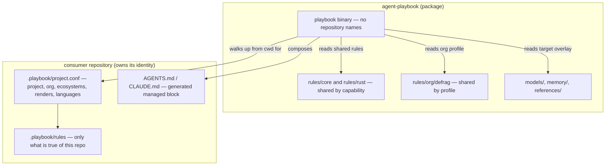

# Inversion audit

**Status** — audit, stages 1–3, 2026-10-25. All twelve repositories and the personal target now own
their configuration. The twelve have both managed blocks installed and checking; `personal`'s
manifest is `fleet/personal/.playbook/project.conf` and `~/.config/zed/AGENTS.md` is installed from
it. Only stage 4 (the cutover) and the deferred skills move remain.

Measured with the composer in this checkout (`cargo run -- rules`, `list`, `check` and `init`),
and with `at-peek`/`at-recall` over the working tree. `cargo test --workspace` passes,
`cargo clippy --workspace --all-targets --all-features -- -D warnings` is clean, and
`cargo fmt --all -- --check` is clean.

## Verdict

`agent-playbook` is currently **two things at once**: a rule package, and a registry of repositories.
It knows 12 projects by name, path, org, language, ecosystem and renderer; it owns 13 rules that
belong to four of them; and three of its eight skills are procedures for named repositories. The
composer's discovery model, its `projects` and `rules` commands, its tests and its packaged data
tree all assume that registry exists.

Inverting the pattern is **contained, not a rewrite**. The rule format, parser, resolution engine,
renderer and installer are already independent of the registry. The registry itself is 12
`project.conf` files, 13 rule files, and 24 references across four source files.

The boundary to enforce:

> Upstream may name an **org**, a **language**, a **capability** (`ecosystems:`, `renders:`) or a
> **target**. It may never name a **repository**.

Everything below is an application of that test.

## 1. The registry as it stands

12 entries, 46 rules in total (13 core, 5 language, 15 org, 13 project), and **0 unreachable**
under the current census.

| Project | Path | Org | Renders | Local rules | Resolves to | Managed block |
| --- | --- | --- | --- | ---: | ---: | --- |
| `archivist` | `~/code/hodlcroft/archivist` | hodlcroft | — | 1 | 20 | not in this workspace — unverified |
| `augminted-bots` | `~/code/defrag/augminted-bots` | defrag | egui, macroquad | 2 | 35 | `AGENTS.md` + `CLAUDE.md` |
| `cnft-dev-workers` | `~/code/defrag/cnft.dev-workers` | defrag | egui | 7 | 37 | `AGENTS.md` + `CLAUDE.md` |
| `compositor` | `~/code/hodlcroft/compositor` | hodlcroft | — | 0 | 19 | not in this workspace — unverified |
| `container-compose` | `~/code/defrag/container-compose` | defrag | — | 0 | 24 | `AGENTS.md` + `CLAUDE.md` |
| `defrag-nix` | `~/code/defrag/defrag-nix` | defrag | — | 0 | 19 | `AGENTS.md` + `CLAUDE.md` |
| `infra` | `~/code/defrag/infra` | defrag | — | 0 | 24 | `AGENTS.md` + `CLAUDE.md` |
| `midnight-lab` | `~/code/defrag/midnight-lab` | defrag | — | 0 | 24 | `AGENTS.md` + `CLAUDE.md` |
| `mitos` | `~/code/defrag/mitos` | defrag | — | 0 | 24 | `AGENTS.md` + `CLAUDE.md` |
| `montager` | `~/code/defrag/montager` | defrag | egui | 0 | 30 | not in this workspace — unverified |
| `personal` | `~/.config/zed` | — | — | 0 | 0 | `~/.config/zed/AGENTS.md` |
| `shared-crates` | `~/code/defrag/shared-crates` | defrag | egui, macroquad | 3 | 36 | `AGENTS.md` + `CLAUDE.md` |

All 12 also declare `ecosystems: defrag` except `personal`; all except `defrag-nix` and `personal`
declare `languages: rust`; all except `personal` declare `default_target: claude-code`.

Three observations:

- **Eight of the twelve have zero local rules.** Their `project.conf` exists only to tell the
  composer which activation axes apply. That is exactly the knowledge the repo should own.
- **The four that do have rules own 13 files / 484 lines** — the part that is genuinely theirs.
- **`personal` is not a repository.** It is the one entry whose "path" is a config directory. That
  is a real special case, not a registry entry that happens to be odd.

Four other repositories are named in prose but are **not** configured: `blackflag` (recorded in
`docs/inventory.md` as not migrated), `construct2` (an incident in
`rules/core/git-is-the-users-domain`), and `docs-and-strategy` / the retired `ecosystem-docs`
(pointers in the cnft rule and memory). They add nothing to the migration count, but they are the
kind of stale pointer that survives a path rewrite unless someone reads the sentences rather than
searching for `projects/`.

## 2. Cross-repo knowledge outside `projects/`

The registry is the main offender, but not the only one. Measured by references to repository names
or paths in files that are not themselves project rules:

| Where | What it carries | Verdict |
| --- | --- | --- |
| `skills/container-compose/SKILL.md` (127 lines) | A complete procedure for one repo | Move to that repo |
| `skills/widget-screenshot/SKILL.md` (130 lines) | The `shared-crates` storybook, its port, Brave | Move to `shared-crates` |
| `skills/game-spike/SKILL.md` (206 lines) | The `fight-macroquad` reference client in `augminted-bots`, `macroquad-gamekit` in `shared-crates` | Move or split; it is a procedure for two repos |
| `memory/environment.md` | A table of six repository paths | Remove the table; keep the `~/code/<org>/<repo>` convention |
| `models/zed/overlay.conf` | `emphasis: defrag-agent-tools` | Fatal for any `zed` project that does not declare `ecosystems: defrag` — see §5.7 |
| `rules/rust/devshell-first.md`, `memory/README.md` | Point at `projects/archivist/rules/devshell-commands.md` | Broken when that rule moves |
| `rules/org/defrag/widget-catalogue-first.md` | Absolute paths into `shared-crates` | Acceptable as an org-level pointer; make it ecosystem-relative, not `~/code/...` |
| `rules/org/defrag/macroquad-traps.md`, `agent-tools.md` | Incidents and examples naming repos | Rationale/examples, not configuration; keep |
| `rules/README.md`, `models/README.md`, `models/generic/overlay.conf` | Worked examples using `archivist`, `compositor`, `shared-crates` | Documentation, not configuration; update the command examples |
| `docs/inventory.md` | The migration's archaeology, with every old path | Keep as history, clearly marked; it is not live config |

The distinction that matters: **an incident in a rationale is not configuration**. A rule may say
"this went wrong in `mitos`" and stay upstream. A rule may not say "apply this to `mitos`".

## 3. What the tool assumes today

| Assumption | Where |
| --- | --- |
| A project is found by matching `path:` against a directory | `claiming_project`, `src/load.rs` |
| Projects are enumerated from a directory | `list_projects`, `census`, `src/load.rs` |
| `--project` is required for repository-scoped commands | `named_project`, `src/main.rs` |
| A playbook root contains `rules/`, `models/` **and** `projects/` | `looks_like_root`, `src/load.rs` |
| Project rules live under `projects/<name>/rules/` | `load_rules`, `src/load.rs` |
| The installed data tree ships `projects/` | `postInstall`, `flake.nix` |
| The block names `projects/<name>` | `render`, `src/render.rs` |
| The tests resolve the real registry | `tests/resolution.rs` |

The registry-specific surface is small: 24 references to `list_projects`, `load_project`,
`claiming_project` or `census` across `load.rs` (9), `main.rs` (6), `resolve.rs` (2) and
`tests/resolution.rs` (7).

## 4. Target shape



The manifest is the repo's declaration of *which shared rules apply to it*. The composer reads it,
adds the repo's own rules, and renders the block. Upstream never learns a repository name.

The block stays **committed**, not generated at build time. An agent reads `AGENTS.md` before any
build runs, and a clone without the playbook must still be able to tell an agent how to work in it.
`check` is what keeps the committed copy honest; a build step would make the file depend on a
toolchain the agent may not have.

### The manifest

Same flat `key: value` format, same parser, no new dependency. Placed at `<repo>/.playbook/project.conf`:

```conf
project: shared-crates
org: defrag
ecosystems: defrag
renders: egui, macroquad
languages: rust
default_target: claude-code
```

`path:` is deliberately **not** carried. The manifest's directory is the repository root; keeping
`path:` would let a manifest claim a different directory, which is the registry in disguise.

Local rules move unchanged to `<repo>/.playbook/rules/`, keeping `layer: project` and
`activation: project:<name>`. The name is redundant, but it is a useful check: a rule copied from
another repo, or a manifest renamed without its rules, is a hard error rather than a silent no-op.

A `.playbook/` directory was chosen over `playbook/` because it mirrors the existing
`projects/<name>/` shape exactly (`project.conf` + `rules/`), so the engine change is "resolve a
project from a repo directory" rather than a new format. A visible `playbook/` is the alternative
if discoverability matters more.

## 5. What must change

### 5.1 Engine

| File | Change |
| --- | --- |
| `src/load.rs` | Replace `list_projects` / `load_project(name)` / `claiming_project` with `find_manifest(start_dir)` and `load_project_at(dir)`. Drop `path:` from `PROJECT_KEYS`. `looks_like_root` stops requiring `projects/`. `load_rules` takes the shared root and an optional project directory. |
| `src/resolve.rs` | `resolve(shared_root, project_dir, target)`; no project name lookup. |
| `src/main.rs` | `compose`, `list`, `install` and `check` discover `.playbook/project.conf` from `--repo` or the working directory. `--project` is removed, with an error that names `.playbook/`; there is no name left to pass. `projects` becomes `project` (print the local manifest) or is removed. `rules` becomes a local census. |
| `src/render.rs` | Provenance line names the manifest, not `projects/<name>`. Rule comments already distinguish themselves: `rules/core/...` versus `.playbook/rules/...`. |
| `src/model.rs` | No new activation is strictly required. Add validation that a local rule's `activation` names the declared project and that its layer is `project`. |
| `src/install.rs` | Unchanged. |

Two new diagnostics are worth adding because inversion removes the registry that used to catch
these: a declared `org:`, `ecosystems:` or `renders:` value that activates **no** rule (a typo), and
a shared rule whose activation is `project:<name>` (a half-migrated rule that can never fire).
Both are warnings or errors at load time, depending on how strict the tree wants to be.

Optionally add:
- `playbook init` — scaffold `.playbook/project.conf` and `rules/` in a repo. This is what makes
  adoption cheap, and it is the natural place to put the "which rules belong here?" prompt.
- `playbook --version` — useful for the pinning discussion in §5.3.

### 5.2 Tests

The real-tree tests that depend on the registry become mechanism tests; the rest stay:

| Today | After |
| --- | --- |
| `every_known_project_resolves_without_errors` | A temp-dir fixture with a manifest resolves; each activation axis is covered |
| `no_rule_is_unreachable` | Every shared rule has a synthetic project that matches its activation; every local rule matches its manifest |
| `project_rules_do_not_leak_between_projects` | A rule in repo A's manifest does not load for repo B |
| `a_project_is_discovered_from_the_directory_it_claims` | `find_manifest` walks up from a subdirectory and stops at the repo root |
| `every_rule_in_the_tree_parses_and_has_a_body` | Unchanged, over shared rules plus fixture-local rules |
| `rendering_is_byte_stable` | Unchanged |

The synthetic projects can be derived from the activation enum rather than stored as fixture
files: for each `Activation` variant, construct the project that satisfies it. That is exhaustive
by construction and carries no repository names. It is weaker than a real consumer in one way —
it cannot prove a rule's prose is *useful* — but that was never what the test proved.

A useful new gate: assert that the packaged shared tree contains no `projects/` directory. That is
the inversion's own invariant, in the same spirit as `no_rule_is_unreachable`.

### 5.3 Packaging and pinning

`flake.nix`:

```nix
postInstall = ''
  mkdir -p $out/share/playbook
  cp -R rules models memory templates $out/share/playbook/
'';
```

`projects/` disappears. `memory/` stays for the personal target. `looks_like_root` no longer
requires `projects/`, so the packaged root still validates.

The devshell in this repository does not put `playbook` on `PATH` today — `direnv exec . playbook`
fails, while `cargo run --` works. That is a rough edge for the inverted workflow, where the first
thing a contributor does is run the composer in its own repo. Adding the package to the devshell
was tried in stage 1 and reverted: a flake input sees **tracked** files only, so `src/init.rs` was
invisible to the build until it was committed, and the shell failed to evaluate. The change lands
once the new module is tracked — do not put it in the same commit as an untracked source file.

Pinning is a separate decision:

| Option | Cost | Trade-off |
| --- | --- | --- |
| Ambient from `defrag-nix` (status quo) | None | Two developers on different lock revs can disagree; `check` reports a false stale until the shell is re-locked |
| `agent-playbook` as a flake input in each repo | One input per repo; `nixpkgs`/`fenix` follow | Reproducible per repo, and CI can run `nix run .#playbook` |
| A `requires_playbook:` key checked against `playbook --version` | A version field and a comparison | Makes a mismatched shell loud, but cannot supply the right one |
| Repo-local pre-commit hook | One hook per repo | Catches staleness locally; not a CI gate |

The pragmatic answer is: keep the devshell-provided binary for local work, add
`playbook --version`, and add a `playbook check` job only to repos that already use Nix in CI.
`shared-crates/ci.yaml` currently installs Rust with `dtolnay/rust-toolchain` and never invokes
Nix, so adding the gate there is a real cost, not a one-line change.

### 5.4 Consumer migration

For each of the 12 entries:

1. Create `.playbook/project.conf` with the current `org`, `ecosystems`, `renders`, `languages` and
   `default_target`.
2. For the four repos with rules, move `projects/<name>/rules/*` to `.playbook/rules/*` and fix
   relative links (see Appendix A).
3. Run `playbook check` in the repo against the packaged root. The block should be byte-identical
   unless the provenance line changes; if it changes, expect a one-time `install` in every repo.
4. Commit the manifest and rules with the block.

The eight repos with zero local rules are the easy half: a manifest and a block check. The four
with rules need a review pass for local paths and for anything that was written as if it lived in
the playbook.

Order matters in one respect: migrate the repos before deleting `projects/`, so a missing manifest
is caught as "this repo has no `.playbook/`" rather than "the rule set vanished". During the
transition the engine can support both sources, with the local manifest taking precedence over the
registry entry.

### 5.5 Skills

| Skill | Recommendation | Why |
| --- | --- | --- |
| `container-compose` | Move to `container-compose/.agents/skills/` | Nothing in it is true of another repo |
| `widget-screenshot` | Move to `shared-crates/.agents/skills/` | It is the storybook procedure; the storybook is there |
| `game-spike` | Move to `shared-crates` (gamekit) or split with `augminted-bots` | It is a procedure over the kit and the reference client; the kit is the durable half |
| `browser-shot`, `inspect-code`, `crate-research`, `capture-rule`, `fleet-ops` | Stay upstream | They are tool or method procedures, not repo procedures |

One thing to verify before moving: **where the harness discovers skills**. The available skills in
this session are loaded from `~/.agents/skills/`, not from a project directory. If Zed does not
scan `<repo>/.agents/skills/`, a repo-owned skill needs an install step (copy or symlink) and the
repo's manifest or README must say so. That is still better ownership than a procedure in a
different repository, but it is not automatic, and it should be stated rather than assumed.

### 5.6 Memory, docs and examples

| File | Change |
| --- | --- |
| `memory/environment.md` | Drop the repository table. Keep "repositories live at `~/code/<org>/<repo>`", which is a convention, not a registry. The paths are now in each repo's manifest. |
| `memory/README.md`, `rules/rust/devshell-first.md` | Stop pointing at `projects/archivist/rules/devshell-commands.md`. Say the replaced advice is recorded in the repository it applied to, or drop the pointer. |
| `README.md` | Replace the `projects/` layout entry and the `--project` examples; describe the package/consumer boundary. |
| `AGENTS.md` | The working notes for this repo: `projects/` references, the "not self-hosted" paragraph, and the layer test. |
| `docs/precedence.md` | Resolution order is unchanged, but the registry examples and the counts are stale — see below. |
| `docs/rule-format.md` | Replace `project:shared-crates` with the manifest rule; remove the stale claim that the composer is POSIX `sh` (it has been Rust since the rewrite). |
| `models/README.md`, `models/generic/overlay.conf` | Update the `--project shared-crates` examples to run inside a repo. |
| `rules/README.md` | The layer table's `projects/<repo>/` row becomes `.playbook/rules/`; the `archivist`/`compositor` examples become generic. |
| `templates/project/` | Becomes the manifest template; drop `path:`. |
| `docs/inventory.md` | Keep as history. It is the record of where the rules came from, and its paths were true at the time. Do not rewrite it; add a header saying it is not live configuration. |

**Existing doc drift, not caused by this change:**

- `docs/precedence.md` says `shared-crates` resolves to 23 rules, `archivist` to 15 and
  `cnft-dev-workers` to 27. The composer reports **36**, **20** and **37**.
- `docs/inventory.md` records `rules/core/rest-over-graphql` as added on 2026-10-18. That file has
  never existed in the repository's history (`at-recall log` returns zero commits for it). The
  census is the truth; the inventory is not.
- `docs/rule-format.md` described the composer as POSIX `sh` — corrected in stage 1 while the
  `.playbook/` section was added.

A docs pass during the inversion should fix these rather than copy them forward.

### 5.7 A target-overlay bug inversion exposes

`models/zed/overlay.conf` carries `emphasis: defrag-agent-tools`. `resolve` treats an emphasis id
that is not in the resolved set as a **fatal error**, which is the right default for a typo.

Today every project composed with `zed` declares `ecosystems: defrag`, so the rule is always
present. After inversion, an external or new repository can use the `zed` target without the defrag
ecosystem, and composition fails with:

```
target `zed` emphasises `defrag-agent-tools`, which is not in this rule set
```

**Reproduced** against a minimal `.playbook/` fixture on 2026-10-25; it is not a hypothetical.

That is a harness overlay carrying org-specific content, which is exactly what `models/README.md`
says an overlay must not do. Options:

1. Remove the emphasis from `zed` (loses the nudge for defrag repos).
2. Split the target: `zed` universal, `zed-defrag` with the emphasis; the manifest picks the target.
3. Let a manifest add emphasis ids, so the consumer owns the claim.
4. Downgrade an unknown emphasis id to a warning (weakens a check that catches real typos).

Recommendation: (2) if the nudge is worth keeping, otherwise (1). Do not choose (4); the error is
the mechanism that makes `emphasis` honest.

**Resolved 2026-10-25 — option (1): the emphasis was removed.** Option (2) was rejected because a
second `zed-defrag` target would duplicate `instruction_files`, the addenda list and
`default_file`, and `overlay.conf` has no inheritance mechanism to keep the two in step — which is
the drift this repository exists to prevent. The `agent-tools` rule already ships in full in every
repository that has the toolkit, and the emphasis was provisional by its own comment. If the nudge
turns out to matter, the shape is emphasis declared by the manifest that owns the claim (option 3),
not a target beside the harness one. `the_zed_target_resolves_for_any_repository` pins both sides
of the ecosystem boundary.

### 5.8 Moving the personal config into `DamonOehlman/fleet`

`personal` is the one target whose output is not inside a repository: it writes
`~/.config/zed/AGENTS.md`. If the manifest moves to the fleet repo, the composer needs to know
where the **manifest** lives separately from where the **block** is written. Three shapes, in
increasing order of engine change:

1. **A CLI split.** `playbook install --manifest <fleet>/personal/.playbook/project.conf --repo ~/.config/zed`.
   The manifest lives with the inventory; the output is named on the command line. `--manifest`
   is the only new flag, and normal repos still discover `.playbook/project.conf` by walking up.
   **Recommended**, and implemented in stage 1 — it is explicit, has no hidden write destination,
   and covers any future non-repo consumer.
2. **A manifest key.** `install_to: ~/.config/zed/AGENTS.md`. Less typing once, but it puts an
   absolute write destination in a committed file and broadens `install` beyond "the repo it is
   in".
3. **A symlink.** Generate `fleet/personal/AGENTS.md` and point `~/.config/zed/AGENTS.md` at it.
   No engine change; the symlink is dotfiles configuration outside both repos. It breaks if the
   fleet checkout moves, and `check` would verify the fleet copy rather than the file Zed reads.

Fleet is already flat `key: value`, so the manifest format fits unchanged:

```conf
project: personal
org:
ecosystems:
renders:
languages:
default_target: zed-personal
```

The personal target's `memory:` still resolves from the upstream tree; only the manifest and the
generated block move. Fleet is private, and the generated personal file contains no secrets (the
memory files are public upstream), so either location is defensible — fleet is the better one if
the file should sit beside the machine inventory it describes.

### 5.9 `defrag-nix` as the ingestion point

Decision: consumers get the composer from `defrag-nix`, not from a direct `agent-playbook` input.
That is already how the devshells work; the inversion changes what it is ingesting, not the wiring.

- The pin is `defrag-nix`'s lock. `playbook root` reports the packaged tree; `--root` still
  overrides it for rule development.
- If the org rules should be "baked in", `defrag-nix` can **assemble a profile tree** at build
  time: copy `agent-playbook`'s `share/playbook` and add `rules/org/defrag/` (and any defrag-only
  material). The source of truth stays in `agent-playbook`; `defrag-nix` becomes the distribution.
  This is the clean reading of "ingestion point", and it lets `agent-playbook`'s own package stay
  org-agnostic if that is wanted later.
- The cost is CI: a repo that does not use Nix (today, `shared-crates`) needs a Nix step to run
  `playbook check`, or a pinned binary fetched another way. A local gate is the fallback, but it
  is not the same guarantee.
- Repos outside the defrag ecosystem have no ingestion point. That is acceptable: they can take
  `agent-playbook` as their own input if they want the composer, or not use it.

#### Single ingestion vs a direct input

`agent-playbook` is an input of `defrag-nix`, not the other way round — a reverse input would be a
cycle. That fixes the available shapes:

| Shape | Copies of `playbook` | Pin lives in | Fleet coherence | Cost |
| --- | ---: | --- | --- | --- |
| Consumer takes `defrag-nix` only | 1 | `defrag-nix`'s lock | One revision for every shell | A rule update is two bumps: `agent-playbook` → `defrag-nix` → consumers |
| Consumer takes both flakes | 2 | The consumer's lock | Repos drift to different rule sets | Independent pinning, but two `playbook` binaries and rules that may name different tool flags |
| Consumer takes `agent-playbook` only | 1 | The consumer's lock | Only for repos outside the ecosystem | No toolchain; the repo supplies its own |
| A parameterised `defrag-nix` shell | 1 | The consumer passes its pin | Per repo | A breaking flake API for every consumer |

A consumer **cannot** make `defrag-nix`'s nested input follow its own. `inputs.agent-playbook.follows
= "defrag-nix/agent-playbook"` on the consumer's direct input resolves to the nested node, which
removes the independent pin; there is no reverse direction. So "both flakes, but one copy and my
own pin" is not available without changing `defrag-nix`.

Decision: **defrag repositories take `defrag-nix` only.** Every defrag shell already carries
`playbook`, `at-*` and `browser-shot` from one revision, and the rules name those tools — versioning
them together is the point. `agent-playbook` stays independently consumable for repositories outside
the ecosystem and for a CI job that only needs the composer.

What "wrapped via `defrag-nix`" means in practice:

- **Thin re-export (what exists today).** `defrag-nix` already exposes
  `packages.{playbook,agent-tools,browser-shot}` from `agent-playbook` and puts them in every shell.
  The inversion changes what `playbook` **reads** — the repository's `.playbook/` — not how it
  arrives. **No `defrag-nix` change is required for a repository to adopt the inverted model.**
- **Org profile (only if `agent-playbook` becomes org-agnostic).** Assemble a tree with
  `share/playbook` plus `rules/org/defrag/`, and either wrap `playbook` with `PLAYBOOK_ROOT` or
  expose a `playbook-defrag` package. That is a `defrag-nix` change, and it is not needed while
  the org rules ship upstream.

The efficient default is therefore the thin re-export, not a new wrapper: the wrapper would only
add value if it distributed something `agent-playbook` no longer ships.

`--override-input defrag-nix/agent-playbook <flake-url>` is the escape hatch for trying a rule
change in one repository before `defrag-nix` is bumped. It is a command-line experiment, not a
committed pin.

## 6. Sequence

| Stage | Work | Checkpoint |
| --- | --- | --- |
| 0 | This audit and the decisions in §9 | Boundary agreed; skills deferred |
| 1 | Engine: manifest discovery, dual-mode resolution, new diagnostics, `playbook init` | Existing 46-rule tree still resolves; tests pass; no repo changed |
| 2 | Migrate the 4 repos with rules: manifest + move rules + fix links | `playbook check` in each repo produces the same block (or only the provenance line differs) |
| 3 | Migrate the 8 manifest-only repos | All 12 have a manifest; every block checks |
| 4 | Cut over: delete `projects/`, drop it from `flake.nix`, remove registry commands/tests | `cargo test`; `playbook rules` is local; packaged root has no `projects/` |
| 5 | Skills, memory, docs, README/AGENTS | A reader can add a rule without being told about `projects/` |
| 6 | Pinning and CI (optional, per repo) | `playbook check` is a gate where the repo can afford it |

Stages 2 and 3 can be done repo by repo. Stage 4 is the point of no return and should not happen
until every repo checks.

Stage 1 is implemented: `find_manifest`/`load_manifest`/`resolve_repo`, `load_rules_for`
with local-rule validation, `.playbook/` discovery in `compose`/`list`/`install`/`check`, a
`--manifest` flag, `playbook init`, and 9 new tests. Legacy `--project` resolution, `playbook
projects` and `playbook rules` are unchanged, so every non-migrated repository's installed block
still checks byte-for-byte.

Stages 2–3 are complete for all twelve repositories, and `personal` is now declared by
`fleet/personal/.playbook/project.conf` (§5.8). Stage 4 — deleting the eleven remaining registry
stubs and the registry commands/tests — is next.

## 7. Effort

Roughly **three to four focused days**, not including review of each repo's block:

| Part | Estimate |
| --- | --- |
| Engine + tests | ~1 day (24 registry references, new discovery, new validation) |
| Manifest + rule migration | ~1 day for 12 manifests and 13 rule files, including link fixes |
| Skills | ~0.5 day, plus a decision on discovery |
| Docs + memory + templates | ~0.5–1 day |
| Personal move to fleet (§5.8) | ~0.25 day, once the shape is chosen |
| Pinning/CI | ~0.5 day, only if taken now |

The engine is the smallest part. The migration and the documentation are the rest, and they are the
parts that need a human read.

## 8. Risks

- **A repo without a manifest.** `check` must fail with an actionable message ("no `.playbook/`
  found; run `playbook init`"), not silently resolve to shared rules only. The current registry
  cannot have this failure; inversion can.
- **A local rule that activates nowhere.** The old census caught this across the fleet. Validate
  each local rule against its own manifest and make an unused local rule an error.
- **A half-migrated shared tree.** A `project:<name>` rule left in `rules/` after the move can
  never fire. Reject it at load time once the registry is gone.
- **Silent activation typos.** With no registry, a misspelled `org` or `languages` value drops a
  whole layer quietly. Warn when a declared value activates no rule.
- **Different playbook revisions.** A block is byte-compared, so an older shell can report a block
  as stale when it is current, or miss a new rule. The pinning decision in §5.3 is the answer.
- **Skills that move but are not discovered.** Verify the harness's search path before claiming a
  repo-owned skill works.
- **Docs drift after the move.** The three existing drifts above are evidence that the docs are not
  self-checking. A `playbook rules` that prints the file it read, and a doc pass at the cutover, are
  the cheap mitigations.

## 9. Decisions recorded

| # | Decision | Consequence |
| --- | --- | --- |
| 1 | Manifest at `.playbook/project.conf` | The existing `projects/<name>/` shape moves into the repo unchanged. |
| 2 | Personal config moves to `DamonOehlman/fleet` | Done: `fleet/personal/.playbook/project.conf`; `~/.config/zed/AGENTS.md` is installed from it and checks. |
| 3 | Org rules stay upstream | `rules/org/defrag/` remains the source of truth. `defrag-nix` may assemble them into the ingested profile (§5.9); that is a packaging decision, not a second copy. |
| 4 | Skills deferred | `container-compose`, `widget-screenshot` and `game-spike` stay put for now; the move is a separate discussion. |
| 5 | `defrag-nix` is the ingestion point | Consumers keep taking `defrag-nix`; the pin lives there. CI gating is a per-repo cost for repos that do not already use Nix. |
| 6 | `zed` drops its org emphasis | The harness target resolves for any repository. The nudge is redundant with the `agent-tools` rule where it applies; if it is needed, emphasis becomes manifest-owned rather than a second target. |

Still open:

- Whether `defrag-nix` assembles an org profile now or keeps re-exporting the full package (§5.9).
- The skills discussion (§5.5), deliberately deferred.

## 10. What does not move

- `rules/core/` — universal constraints.
- `rules/rust/` — language constraints.
- `rules/org/defrag/` — the shared org profile the consumer opts into.
- `models/` — harness and model overlays (subject to §5.7).
- `memory/` — personal facts, minus the repository table.
- `references/` — crate research.
- `tools/` — the inspectors, browser-shot and the thread tools.
- `templates/` and `docs/` — the package's own documentation and scaffolds.

## 11. Migration log

| Date | Repo | Manifest | Rules moved | Blocks | Verification |
| --- | --- | --- | --- | --- | --- |
| 2026-10-25 | `shared-crates` | org/ecosystems `defrag`, renders `egui, macroquad`, languages `rust`, target `claude-code` | 3: `subdir-devshell`, `gamekit-takes-time-as-an-argument`, `storybook-registration` | `AGENTS.md` (zed) + `CLAUDE.md` (claude-code) | 36 rules; both `check` ok |
| 2026-10-25 | `cnft-dev-workers` | org/ecosystems `defrag`, renders `egui`, languages `rust`, target `claude-code` | 7: `cross-service-contracts`, `d1-write-economics`, `metadata-resolution-chain`, `ncli`, `type-placement`, `typed-api-responses`, `wasm-safe-serde` | both | 37 rules; both `check` ok |
| 2026-10-25 | `augminted-bots` | org/ecosystems `defrag`, renders `egui, macroquad`, languages `rust`, target `claude-code` | 2: `browser-capture`, `macroquad-client-bundles` | both | 35 rules; both `check` ok |
| 2026-10-25 | `defrag-nix` | org/ecosystems `defrag`, no languages, target `claude-code` | 0 | both | 19 rules; both `check` ok |
| 2026-10-25 | `infra`, `mitos`, `midnight-lab`, `container-compose` | org/ecosystems `defrag`, languages `rust`, target `claude-code` | 0 | both | 24 rules each; both `check` ok |
| 2026-10-25 | `archivist` | org `hodlcroft`, ecosystem `defrag`, languages `rust`, target `claude-code` | 1: `devshell-commands` | both | 20 rules; both `check` ok |
| 2026-10-25 | `compositor` | org `hodlcroft`, ecosystem `defrag`, languages `rust`, target `claude-code` | 0 | both | 19 rules; both `check` ok |
| 2026-10-25 | `montager` | org/ecosystems `defrag`, renders `egui`, languages `rust`, target `claude-code` | 0 | both | 30 rules; both `check` ok |
| 2026-10-25 | `viewer` (new) | org `hodlcroft`, ecosystem `defrag`, languages `rust`, target `claude-code` | 0 | both (created) | 19 rules; both `check` ok |
| 2026-10-25 | `personal` (in `fleet`) | no org, ecosystems, renders or languages; target `zed-personal` | 0 | `~/.config/zed/AGENTS.md` | 0 rules, 2 memory sections; `check` ok |

The `archivist` move required two upstream pointer fixes: `rules/rust/devshell-first.md` and
`memory/README.md` no longer name `projects/archivist/rules/devshell-commands.md`; they name the
`archivist` repository's own devshell rule instead. `viewer` is not in the registry: it was
provisioned with `playbook init`, then the manifest was given `org: hodlcroft`,
`ecosystems: defrag` and `languages: rust`, and both blocks were created.

The `personal` move created `fleet/personal/.playbook/` with `playbook init`, left the activation
axes empty, and reinstalled `~/.config/zed/AGENTS.md` with
`--manifest …/fleet/personal/.playbook/project.conf --repo ~/.config/zed`. The block diff is the
provenance line only — 111 lines before and after — so the composed instructions are unchanged.
`projects/personal/` was deleted from the playbook, so the old `--project personal` command can no
longer overwrite the file.

The `archivist`, `compositor` and `montager` blocks were generated from an **older** shared rule
set. Reinstalling brought them current, so their diffs include the tightened
`git-is-the-users-domain`, the expanded `agent-tools` rule and the `at-crate` additions — not only
the provenance line. That is the intended effect of `install`, but it makes their review larger
than the other repositories'. Archivist's total diff also contains a pre-existing `flake.lock`
change that this migration did not touch.

The `shared-crates` block diff is the provenance line, the three rule comments moving from
`projects/shared-crates/rules/…` to `.playbook/rules/…`, and one re-wrapped sentence where the
`widget-screenshot` link became a code span. No rule body changed. The `cnft-dev-workers` and
`augminted-bots` diffs are the same shape, plus two link fixes:

- `augminted-bots/.playbook/rules/browser-capture.md` no longer points at
  `~/code/defrag/agent-playbook/tools/browser-shot/SCENARIO.md`; it points at the `browser-shot`
  skill, which is where the procedure lives.
- `cnft-dev-workers/.playbook/rules/typed-api-responses.md` no longer links to
  `../../../rules/core/typed-json-only.md`; it names the rule as a code span.

The five manifest-only repositories changed only the provenance line in each block.

Three tests were updated for the new source rather than to make a failure go away:

- `layer_order_is_core_then_language_then_org_then_project` is now a synthetic fixture with all
  four layers. The invariant is unchanged.
- `project_rules_do_not_leak_between_projects` is now entirely local: a rule in one manifest must
  not load for a sibling. The registry no longer carries any in-workspace project rules to test.
- `org_rules_do_not_leak_into_another_org` now uses a synthetic `org: hodlcroft` /
  `ecosystems: defrag` manifest resolved against the real tree, and asserts the same three things:
  no `org:defrag` rules, the ecosystem rule arrives, and the repository's own rule arrives.

`projects/<repo>/project.conf` remained for every migrated repository as an empty registry stub
during stages 2–3. Stage 4 deleted all eleven, and the `projects/` directory with them.

### Stage 4 — the cutover, 2026-10-25

- `list_projects`, `load_project`, `claiming_project` and `Project.path` are gone. `Project.repo`
  is the directory the manifest was found in, so nothing needs to match a `path:` against anything.
- `resolve(root, name, target)` is gone; `resolve_repo(root, repo, target)` is the only entry
  point. `load_rules_for` reads `rules/` and `<repo>/.playbook/rules/`, and a `project:` rule in
  the shared tree is now an **error** rather than an orphan.
- `census` computes reach from the activation a manifest could declare, not from a registry.
  `playbook rules` prints `reaches` and reports 33 rules, 0 unreachable.
- `playbook projects` was removed, and `--project` was removed (`init` takes `--name`).
- `flake.nix` no longer copies `projects/` into `share/playbook`.
- Tests rewritten against the real tree as `ManifestedRepo` fixtures, with the invariant that
  every activation a shared rule carries is one a manifest can state. Two new gates:
  `the_package_carries_no_repository_registry` and `a_project_rule_in_the_shared_tree_is_an_error`.
- Docs updated: `README.md`, `AGENTS.md`, `docs/precedence.md` (worked-example counts corrected to
  36/20/37), `docs/rule-format.md`, `docs/inventory.md`, `models/README.md`,
  `models/generic/overlay.conf`, `rules/README.md`, `skills/capture-rule/SKILL.md` and the
  templates.

The `zed` overlay's `emphasis: defrag-agent-tools` was dropped (decision 6). That changed the zed
block for all twelve repositories — the `## Non-negotiable` preamble is gone — and each
`AGENTS.md` was reinstalled. `CLAUDE.md` did not change.

Verification after the cutover: `cargo fmt --all`, `cargo clippy --workspace --all-targets
--all-features -- -D warnings` and `cargo test --workspace` clean; `playbook check` ok for all
twelve repositories against both targets and for the personal file. The composer's suite is 56
unit tests, 2 reference tests and 48 resolution tests.

## Appendix A — cross-references that break when rules move

| Reference | Where | Fix |
| --- | --- | --- |
| `projects/archivist/rules/devshell-commands.md` | `rules/rust/devshell-first.md` rationale | Done — names the `archivist` repository's own rule |
| Same | `memory/README.md` | Done — same |
| `../../../skills/widget-screenshot/SKILL.md` | `shared-crates/.playbook/rules/subdir-devshell.md` | Done — replaced with a `widget-screenshot` code span |
| `~/code/defrag/agent-playbook/tools/browser-shot/SCENARIO.md` | `augminted-bots/.playbook/rules/browser-capture.md` | Done — points at the `browser-shot` skill |
| `~/code/defrag/shared-crates/ui/.../CATALOG.md` | `rules/org/defrag/widget-catalogue-first.md` | Done — names `ui/egui-widgets/CATALOG.md` in the `shared-crates` repository |
| `shared-crates/gaming/macroquad-gamekit/CATALOG.md` | `rules/org/defrag/macroquad-traps.md` | Already ecosystem-relative |
| `~/code/hodlcroft/compositor` | `rules/org/defrag/agent-tools.md` rationale | Keep as an example, or generalise |
| `projects/<repo>/` in command examples | `README.md`, `AGENTS.md`, `models/README.md`, `models/generic/overlay.conf`, `rules/README.md`, `docs/precedence.md` | Done — `--project` removed; every example runs inside the repository |

## Appendix B — what was measured

- `playbook rules` (registry view): 33 rules, 0 unreachable after all moves (46 before them).
  The stubs report 33 (`shared-crates`), 30 (`cnft-dev-workers`), 33 (`augminted-bots`),
  19 (`archivist`), 19 (`compositor`) and 30 (`montager`). The repositories report 36, 37, 35,
  20, 19 and 30. The five manifest-only repositories report 19 (`defrag-nix`) and 24 (`infra`,
  `mitos`, `midnight-lab`, `container-compose`). `viewer` is not in the registry and reports 19.
- `playbook list --project …` before the migration: 20 (`archivist`), 35 (`augminted-bots`), 37
  (`cnft-dev-workers`), 19 (`compositor`), 24 (`container-compose`), 19 (`defrag-nix`), 24
  (`infra`), 24 (`midnight-lab`), 24 (`mitos`), 30 (`montager`), 0 (`personal`, 2 memory
  sections), 36 (`shared-crates`).
- `playbook check` for all twelve repositories, both targets: ok. The first eight were in sync
  before the migration; the `archivist`, `compositor` and `montager` blocks were stale and were
  refreshed.
- `personal`: 0 rules, 2 memory sections; `~/.config/zed/AGENTS.md` checks against
  `fleet/personal/.playbook/project.conf`. `projects/personal/` is gone from the playbook, so the
  registry has no personal entry and `playbook projects` lists only the eleven repository stubs.
- `at-peek stat` over the 13 project rules: 484 lines total.
- `at-peek stat` over the three project-specific skills: 463 lines total.
- `at-peek search "BEGIN agent-playbook"`: 8 repositories in this workspace have a block in both
  files.
- Stage 1 smoke test, in a `.tmp/` fixture: `playbook init --project proof --target generic`
  created the manifest and `rules/`; `list` resolved 13 core rules; `install` wrote a block whose
  provenance names `.playbook/project.conf`; `check` passed; `list --manifest` and `install
  --manifest … --repo …` worked from outside the repository; and `--target zed` failed on the
  missing `defrag-agent-tools` emphasis, reproducing §5.7.
